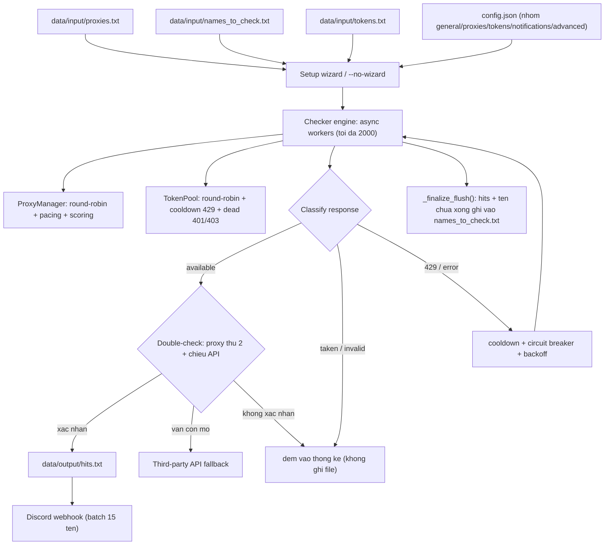

# Discord Username Finder

Công cụ check username Discord tốc độ cao, chạy async thuần, giao diện ANSI thuần (không cần rich) và không bắt buộc token Discord.


---

## Demo

Mô phỏng khối live card khi đang chạy (lấy theo `live_card()` trong `src/ui.py`, giao diện ANSI thuần, không vẽ khung box):

```text
  Discord Username Finder v3.1  ● RUNNING  00:04:12

  discord.com/api/v9/unique-username  ›  Static Pool (142 alive)  ›  500 workers (timeout 10s)

  Progress           : ━━━━━━━━──────────── 42.7%  (4,270 / 10,000)
  Available Hits     : 12
  Taken / Invalid    : 4,241
  Total Requests     : 4,318
  Speed              : 186.4 req/s  ›  92.1 checks/s
  Rate Limited       : 17
  Circuit Breaks     : 2
  Errors             : cf_ban_park 9  ›  timeout 4  ›  429_park 2
  Recent Hits        : litwex, nova.ko, qx_7, mirror.d

  [12:04:10] + nova.ko available
  [12:04:11] + qx_7 available
  [12:04:12] ~ 429_park 60s (proxy pool)

  [Ctrl+C to stop and save progress]
```

---

## Tính năng

- **Đa luồng async**: hàng trăm đến hàng nghìn worker cùng lúc, hard cap `MAX_CONCURRENCY = 2000` (`src/config.py`) để asyncio/aiohttp không stall; worker stagger khi khởi động tránh dội request đồng loạt.
- **Proxy linh hoạt**: bể static xoay vòng bằng deque với pacing (giãn cách tối thiểu mỗi lần cấp phát), bể free/scraped chấm điểm `score_hit` (+5, cap 100) / `score_miss` (-1, score <= 0 thì loại) theo weighted random; per-proxy cooldown, park khi 429, hồi sinh proxy soft-dead.
- **Token Pool xoay vòng**: `TokenPool` lấy token kế tiếp theo round-robin, bỏ qua token dead và token đang cooldown; cooldown 429 theo `retry_after` (clamp 0.5 đến 1800s), đánh dấu dead khi 401/403; hết token sống thì tự chuyển sang chế độ unauthed (hybrid) thay vì dừng.
- **Double-check chống hit ảo**: hit `AVAILABLE` được xác nhận lại bằng proxy thứ hai và đối chiếu chéo API (`token` `pomelo-attempt` với `unauthed` `username-attempt-unauthed`) khi có thể; nếu vẫn còn mờ thì chuyển sang third-party API fallback (`third_party_api_url`).
- **Webhook Discord theo lố**: `WebhookSender` tích lũy hit rồi flush theo batch (mỗi 15 tên / 1950 ký tự / 3 giây), có backoff, drain queue cuối phiên và ghi phần gửi lỗi ra `webhook_failed.txt` (at-least-once).
- **Circuit breaker**: mở mạch khi quá nhiều lỗi liên tiếp (threshold 10 trong cửa sổ 2s, cooldown 2s) để mọi worker nghỉ ngắn, tránh thundering herd trên proxy đang chết.
- **Lưu progress an toàn khi Ctrl+C**: `finally` gọi `_finalize_flush()` ghi `hits.txt` và giữ lại tên chưa xong trong `data/input/names_to_check.txt`; tên đã xử lý xong tự được gỡ khỏi file nên lần chạy sau chỉ còn đúng phần chưa làm (không sinh file `checked.tsv`).
- **Giao diện ANSI thuần**: không phụ thuộc rich; hiển thị Progress, Available Hits, Taken / Invalid, Total Requests, Speed (req/s và checks/s), Rate Limited, Circuit Breaks, Errors theo loại, Recent Hits và feed hoạt động gần nhất.
- **Header giả lập trình duyệt**: tự cào `client_build_number` từ Discord web client để làm mới `X-Super-Properties`, kèm SSL context theo thứ tự cipher của Chrome.

---

## Cảnh báo & An toàn

- Tool gọi endpoint đăng ký username của Discord. Dùng kèm **tài khoản/token thật** có thể vi phạm Điều khoản dịch vụ của Discord (risk lock, captcha, ban). Hãy dùng cho mục đích nghiên cứu và test.
- Proxy free/public không ổn định và có thể ghi log lưu lượng của bạn. Không dùng dữ liệu nhạy cảm sau lưng proxy không tin cậy.
- Repo đã kèm `.gitignore` chặn `config.json`, `data/input/tokens*.txt`, `data/input/proxies.txt`, `data/input/names_to_check.txt` và `data/output/*` để không commit nhầm bí mật. Vẫn nên kiểm tra `git status` trước khi commit.
- Nhóm hỗ trợ không chịu trách nhiệm cho cách bạn sử dụng công cụ này.

---

## Cài đặt & Quick start

**Yêu cầu**: Python 3.9 trở lên.

```bash
# Tải repo về (Download ZIP hoặc git clone với URL GitHub của bạn)
cd DiscordUsernameChecker-main
pip install -r requirements.txt
```

`requirements.txt` gồm 2 thư viện:

```text
aiohttp>=3.9.0
curl_cffi>=0.7.0
```

**Cấu hình `config.json`** (tự tạo `{}` nếu thiếu, nằm ở project root). File được **phân nhóm theo mục** cho rõ ràng; code đọc theo tên key phẳng nên bố cục đổi không ảnh hưởng logic:

```json
{
  "general": { "concurrency": 20, "timeout": 10, "last_names_file": "data/input/names_to_check.txt" },
  "proxies": { "proxy_mode": "static", "remove_proxies": true, "last_proxy_file": "data/input/proxies.txt" },
  "tokens": { "use_tokens": true },
  "notifications": { "webhook": "" },
  "advanced": { "third_party_api_url": "" }
}
```

| Nhóm | Key | Ý nghĩa |
| --- | --- | --- |
| `general` | `concurrency`, `timeout` | số worker và timeout (mặc định `--no-wizard`: 50 / 10) |
| `general` | `last_names_file` | file tên dùng lần trước (path tương đối, tự resolve theo project root) |
| `proxies` | `proxy_mode` | nguồn proxy lần trước: `scraped` / `static` / `none` |
| `proxies` | `last_proxy_file` | file proxy dùng lần trước |
| `proxies` | `remove_proxies` | tự loại proxy chết trong phiên |
| `tokens` | `use_tokens` | bật chế độ token (đọc `data/input/tokens.txt`) |
| `notifications` | `webhook` | URL webhook Discord; **để rỗng thì tắt webhook** |
| `advanced` | `third_party_api_url` | API kiểm tra phụ cho double-check; rỗng thì bỏ qua bước này |

Path file được lưu **tương đối** theo project root (không lộ đường dẫn tuyệt đối của máy bạn). Các cờ nâng cao cũ (`auto_scrape_build`, `use_fingerprint`, `reuse_proxies`) đã gỡ khỏi file — hành vi mặc định vẫn giữ nguyên.

**Các lệnh chạy thật** (xem `main.py` và `parse_args()` trong `src/checker.py`):

```bash
python main.py                 # mặc định: chạy setup wizard tương tác
python main.py --no-wizard     # bỏ qua wizard, dùng config.json + file đã lưu
python main.py -n              # tương đương --no-wizard
python main.py -d              # bật debug log request/response (--debug)
python main.py --version       # in phiên bản rồi thoát
```

Chỉ có 3 flag: `-d/--debug`, `-n/--no-wizard`, `--version`.

**File input** (đảm bảo tồn tại, tool tự tạo nếu thiếu):

```text
data/input/proxies.txt           # mỗi dòng một proxy
data/input/names_to_check.txt    # mỗi dòng một username cần check
data/input/tokens.txt            # mỗi dòng một token (chỉ cần khi use_tokens = true)
```

Định dạng proxy được chấp nhận:

```text
host:port
user:pass@host:port
host:port:user:pass
http://host:port
```

(Không hỗ trợ `socks4://`, `socks5://`.)

---

## Cấu trúc thư mục & luồng xử lý

```text
DiscordUsernameChecker-main/
|-- main.py                  # entry point mỏng, gọi src.checker.main()
|-- config.json              # cấu hình lưu trữ (webhook, concurrency, ...)
|-- requirements.txt         # aiohttp>=3.9.0, curl_cffi>=0.7.0
|-- .gitignore               # chan secrets (config, tokens, proxies) khoi git
|-- LICENSE                  # giay phep MIT
|-- README.md
|-- src/
|   |-- __init__.py
|   |-- checker.py           # CLI argparse, wizard hook, workers, writer hits
|   |-- config.py            # VERSION 3.1.0, DEFAULT_*, MAX_CONCURRENCY, Config JSON
|   |-- engine.py            # Checker engine, CircuitBreaker, WebhookSender, ThirdPartyResolver
|   |-- http_backend.py      # backend HTTP (aiohttp / curl_cffi), phân loại lỗi
|   |-- proxy.py             # ProxyManager: rotation, cooldown, scoring, pacing
|   |-- token_pool.py        # TokenPool: round-robin, cooldown 429, mark_dead
|   |-- ui.py                # banner, live_card, thanh tiến độ (ANSI thuần)
|   |-- wizard.py            # setup wizard tương tác
|-- tests/
|   |-- conftest.py
|   |-- test_*.py            # 27 file test, 377 test case
|-- data/
    |-- input/
    |   |-- .gitkeep           # giu thu muc trong repo (file that duoc gitignore)
    |   |-- proxies.txt
    |   |-- names_to_check.txt
    |   |-- tokens.txt
    |   |-- tokens_dead.txt
    |-- output/
        |-- .gitkeep           # giu thu muc trong repo
        |-- hits.txt
```

Lưu ý: repo hiện không kèm `config.example.json`; `config.json` được tạo tự động dạng `{}` nếu chưa có.

Sơ đồ luồng xử lý:



---

## Troubleshooting / FAQ

1. **`curl_cffi` lỗi build / `ImportError` khi cài** - đổi sang backend `aiohttp` (bỏ cài curl_cffi) hoặc dùng Python 3.11 trở lên để có wheel sẵn.
2. **`No proxies found` / `Không tìm thấy proxy`** - kiểm tra `data/input/proxies.txt`: mỗi dòng đúng `host:port`, `login:pass@host:port` hoặc `host:port:user:pass`; không để JSON lẫn vào, không dùng `socks4://`, `socks5://`.
3. **Token báo 401/403** - token đã chết; tool chỉ đánh dead trong phiên, bạn chuyển token đó sang `data/input/tokens_dead.txt` rồi chạy lại; nếu hết token sống tool tự chạy unauthed.
4. **429 hàng loạt** - tool tự cooldown proxy/token và mở circuit breaker; nếu vẫn bị thì giảm `concurrency` trong `config.json`, tăng số proxy hoặc chờ ban Cloudflare (15 đến 30 phút) hết hạn.
5. **Bấm Ctrl+C giữa chừng** - tiến độ được lưu: hit vào `data/output/hits.txt`, tên chưa check giữ lại trong `data/input/names_to_check.txt`; chạy lại chỉ tốn request cho đúng phần còn lại.

---

## Connect & Support

- Discord: https://discord.gg/rxw8Hwk3qA
- TikTok: https://www.tiktok.com/@lakofusion
- YouTube: https://www.youtube.com/@lakofusion2010

---

## License

MIT License

Copyright (c) 2026 Lako & Discord Username Finder Contributors

Permission is hereby granted, free of charge, to any person obtaining a copy
of this software and associated documentation files (the "Software"), to deal
in the Software without restriction, including without limitation the rights
to use, copy, modify, merge, publish, distribute, sublicense, and/or sell
copies of the Software, and to permit persons to whom the Software is
furnished to do so, subject to the following conditions:

The above copyright notice and this permission notice shall be included in all
copies or substantial portions of the Software.

THE SOFTWARE IS PROVIDED "AS IS", WITHOUT WARRANTY OF ANY KIND, EXPRESS OR
IMPLIED, INCLUDING BUT NOT LIMITED TO THE WARRANTIES OF MERCHANTABILITY,
FITNESS FOR A PARTICULAR PURPOSE AND NONINFRINGEMENT. IN NO EVENT SHALL THE
AUTHORS OR COPYRIGHT HOLDERS BE LIABLE FOR ANY CLAIM, DAMAGES OR OTHER
LIABILITY, WHETHER IN AN ACTION OF CONTRACT, TORT OR OTHERWISE, ARISING FROM,
OUT OF OR IN CONNECTION WITH THE SOFTWARE OR THE USE OR OTHER DEALINGS IN THE
SOFTWARE.
