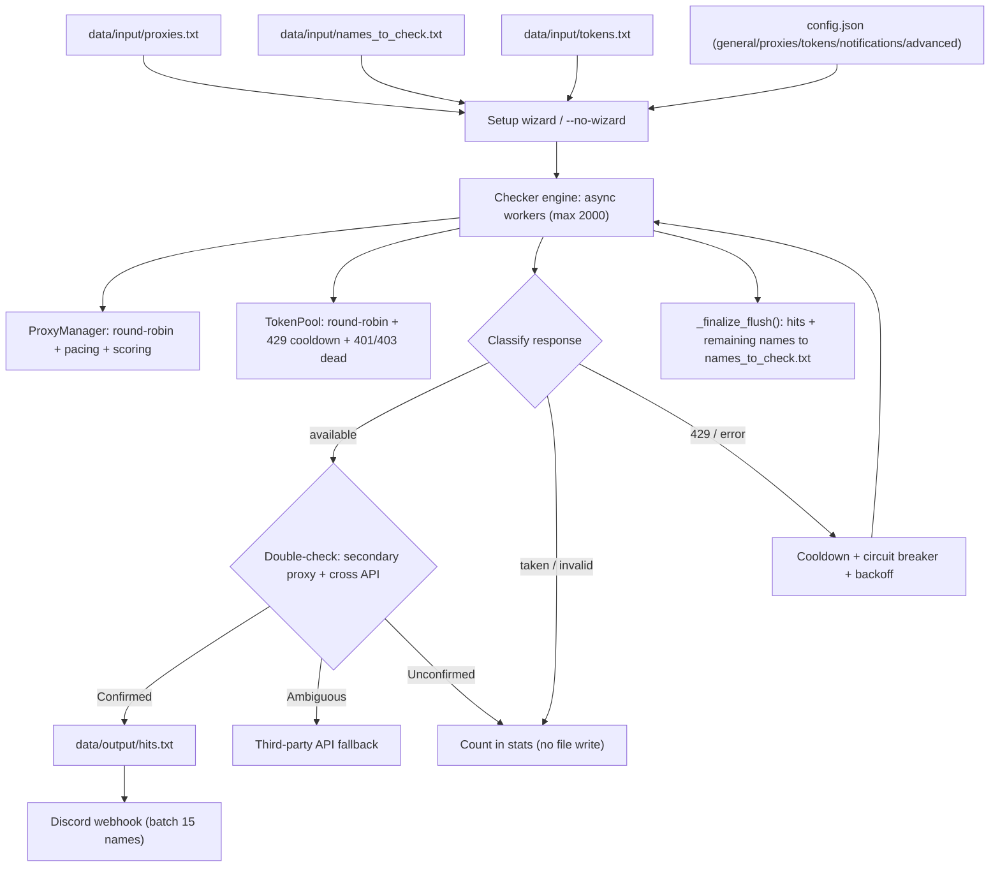

# Discord Username Finder

High-speed Discord username checker featuring pure asynchronous execution, a pure ANSI interface (no Rich dependency required), and no mandatory Discord token.


---

## Demo

Simulation of the live card view during runtime (derived from `live_card()` in `src/ui.py`, pure ANSI interface with borderless styling):

```text
  Discord Username Finder v3.1  ● RUNNING  00:04:12

  discord.com/api/v9/unique-username  ›  Static Pool (142 alive)  ›  500 workers (timeout 10s)

  Progress           : ━━━━━━━━──────────── 42.7%  (4,270 / 10,000)
  Available Hits     : 12
  Taken / Invalid    : 4,241
  Total Requests     : 4,318
  Speed              : 186.4 req/s  ›  92.1 checks/s
  Rate Limited       : 17
  Circuit Breaks     : 2
  Errors             : cf_ban_park 9  ›  timeout 4  ›  429_park 2
  Recent Hits        : litwex, nova.ko, qx_7, mirror.d

  [12:04:10] + nova.ko available
  [12:04:11] + qx_7 available
  [12:04:12] ~ 429_park 60s (proxy pool)

  [Ctrl+C to stop and save progress]
```

---

## Features

- **Async Multi-Worker Architecture**: Scales from hundreds to thousands of concurrent workers with a hard limit of `MAX_CONCURRENCY = 2000` (`src/config.py`) to prevent asyncio/aiohttp event loop starvation; worker startup staggering avoids sudden request bursts.
- **Flexible Proxy Management**: Rotates static proxy pools using a deque with pacing (minimum interval per allocation); scores free/scraped proxy pools with `score_hit` (+5, capped at 100) and `score_miss` (-1, evicted when score <= 0) via weighted random selection; supports per-proxy cooldowns, 429 parking, and soft-dead proxy revival.
- **Rotating Token Pool**: `TokenPool` selects tokens via round-robin, bypassing dead tokens and those currently on cooldown; clamps 429 cooldowns based on `retry_after` (between 0.5s and 1800s); marks tokens dead on 401/403 responses; automatically degrades to unauthenticated (hybrid) mode instead of crashing when all tokens are exhausted.
- **Double-Check False-Positive Mitigation**: Every `AVAILABLE` hit is cross-verified using a secondary proxy and alternative API endpoints (`token` `pomelo-attempt` vs. `unauthed` `username-attempt-unauthed`) whenever possible; falls back to an external third-party lookup API (`third_party_api_url`) if ambiguity persists.
- **Batched Discord Webhook Delivery**: `WebhookSender` queues hits and dispatches them in batches (every 15 names / 1,950 characters / 3 seconds) with exponential backoff; drains pending queues on exit and logs delivery errors to `webhook_failed.txt` for an at-least-once guarantee.
- **Circuit Breaker Pattern**: Opens the circuit breaker when error spikes occur (threshold of 10 consecutive failures within a 2-second window, 2-second cooldown) to briefly pause workers and prevent cascading failures on degraded proxies.
- **Safe Progress Persistence on Ctrl+C**: The `finally` handler invokes `_finalize_flush()` to write hits to `hits.txt` and retain unverified names in `data/input/names_to_check.txt`; completed names are pruned directly from the input file so resuming only processes remaining work (no auxiliary `checked.tsv` needed).
- **Pure ANSI Terminal UI**: Zero third-party terminal styling dependencies; dynamically displays progress, available hits, taken/invalid tallies, total requests, throughput metrics (req/s and checks/s), rate limits, circuit breaks, categorized errors, recent hits, and live event logs.
- **Browser Signature Emulation**: Dynamically parses `client_build_number` from the Discord web client to refresh `X-Super-Properties`, combined with custom SSL ciphers matching modern Chrome releases.

---

## Warnings & Disclaimer

- This tool sends requests to Discord username registration endpoints. Using this tool with **real accounts or personal tokens** carries the risk of Terms of Service violations (including account locks, CAPTCHA challenges, or permanent suspensions). Use strictly for research and testing purposes.
- Free and public proxies are inherently unstable and may log or inspect network traffic. Never route sensitive credentials through unverified public proxies.
- The repository includes a `.gitignore` configured to exclude `config.json`, `data/input/tokens*.txt`, `data/input/proxies.txt`, `data/input/names_to_check.txt`, and `data/output/*` to prevent unintentional credential leaks. Always verify `git status` prior to pushing commits.
- The authors and maintainers accept no liability for any misuse or damages resulting from the use of this software.

---

## Installation & Quick Start

**Requirements**: Python 3.9 or higher.

```bash
# Clone the repository (or download ZIP)
cd DiscordUsernameChecker-main
pip install -r requirements.txt
```

`requirements.txt` dependencies:

```text
aiohttp>=3.9.0
curl_cffi>=0.7.0
```

**Configuring `config.json`** (automatically generated as `{}` if missing, located at project root). Settings are **grouped into sections** for clarity; the application parses keys flatly, so formatting adjustments will not affect execution:

```json
{
  "general": { "concurrency": 20, "timeout": 10, "last_names_file": "data/input/names_to_check.txt" },
  "proxies": { "proxy_mode": "static", "remove_proxies": true, "last_proxy_file": "data/input/proxies.txt" },
  "tokens": { "use_tokens": true },
  "notifications": { "webhook": "" },
  "advanced": { "third_party_api_url": "" }
}
```

| Section | Key | Description |
| --- | --- | --- |
| `general` | `concurrency`, `timeout` | Worker concurrency limit and network timeout (defaults with `--no-wizard`: 50 / 10) |
| `general` | `last_names_file` | Target username file path from the previous session (relative to project root) |
| `proxies` | `proxy_mode` | Proxy pool mode: `scraped` / `static` / `none` |
| `proxies` | `last_proxy_file` | Proxy file path used in the previous run |
| `proxies` | `remove_proxies` | Automatically evicts unresponsive proxies during the run |
| `tokens` | `use_tokens` | Enables token-authenticated checks (reads `data/input/tokens.txt`) |
| `notifications` | `webhook` | Discord incoming webhook URL; **leave empty to disable notifications** |
| `advanced` | `third_party_api_url` | Auxiliary API endpoint for hit double-checks; leave empty to skip |

File paths are stored **relative** to the project root directory (preventing exposure of local system paths). Legacy flags (`auto_scrape_build`, `use_fingerprint`, `reuse_proxies`) have been removed from the file while preserving default behavior.

**CLI Commands** (see `main.py` and `parse_args()` in `src/checker.py`):

```bash
python main.py                 # Default: Launches interactive setup wizard
python main.py --no-wizard     # Bypasses wizard, reads config.json and saved file paths
python main.py -n              # Alias for --no-wizard
python main.py -d              # Enables verbose request/response debugging (--debug)
python main.py --version       # Displays current version and exits
```

Available flags: `-d/--debug`, `-n/--no-wizard`, `--version`.

**Input Files** (automatically created with boilerplate if missing):

```text
data/input/proxies.txt           # One proxy per line
data/input/names_to_check.txt    # One username per line
data/input/tokens.txt            # One token per line (required only if use_tokens = true)
```

Supported proxy formats:

```text
host:port
user:pass@host:port
host:port:user:pass
http://host:port
```

(`socks4://` and `socks5://` protocols are not supported.)

---

## Directory Structure & Flowchart

```text
DiscordUsernameChecker-main/
|-- main.py                  # Lightweight entry point, calls src.checker.main()
|-- config.json              # Configuration file (webhook, concurrency, etc.)
|-- requirements.txt         # aiohttp>=3.9.0, curl_cffi>=0.7.0
|-- .gitignore               # Ignores sensitive data (config, tokens, proxies)
|-- LICENSE                  # MIT License
|-- README.md
|-- src/
|   |-- __init__.py
|   |-- checker.py           # CLI parsing, wizard integration, worker loop, hit writer
|   |-- config.py            # VERSION 3.1.0, DEFAULT_*, MAX_CONCURRENCY, Config JSON handler
|   |-- engine.py            # Checker engine, CircuitBreaker, WebhookSender, ThirdPartyResolver
|   |-- http_backend.py      # HTTP client backend (aiohttp / curl_cffi), error classification
|   |-- proxy.py             # ProxyManager: rotation, cooldowns, scoring, pacing
|   |-- token_pool.py        # TokenPool: round-robin, 429 cooldown, mark_dead
|   |-- ui.py                # ANSI terminal banner, live_card, progress indicators
|   |-- wizard.py            # Interactive setup CLI wizard
|-- tests/
|   |-- conftest.py
|   |-- test_*.py            # 27 test files, 377 test cases
|-- data/
    |-- input/
    |   |-- .gitkeep           # Keeps directory in VCS (actual files are gitignored)
    |   |-- proxies.txt
    |   |-- names_to_check.txt
    |   |-- tokens.txt
    |   |-- tokens_dead.txt
    |-- output/
        |-- .gitkeep           # Keeps directory in VCS
        |-- hits.txt
```

*Note: The repository does not supply a `config.example.json`; `config.json` is initialized automatically as `{}` if not found.*

Execution Flowchart:



---

## Troubleshooting / FAQ

1. **`curl_cffi` build failures or `ImportError` on install** — Switch to the pure `aiohttp` backend (remove `curl_cffi` from requirements) or run on Python 3.11+ where pre-built wheels are standard.
2. **`No proxies found` error** — Check `data/input/proxies.txt`: ensure each entry strictly follows `host:port`, `login:pass@host:port`, or `host:port:user:pass`. Avoid JSON formatting or comments; `socks4://` and `socks5://` are not supported.
3. **Tokens returning 401/403 errors** — The token is invalid or terminated. The engine marks it dead for the current session; move it to `data/input/tokens_dead.txt` before restarting. If all tokens fail, the tool continues in unauthenticated mode automatically.
4. **Mass 429 Rate Limits** — The tool automatically applies cooldowns to affected proxies/tokens and triggers the circuit breaker. If rate limiting continues, lower `concurrency` in `config.json`, provide a larger proxy list, or wait for the temporary Cloudflare restriction (typically 15–30 minutes) to clear.
5. **Interrupting with Ctrl+C** — Progress is preserved automatically: discovered hits are committed to `data/output/hits.txt`, and unverified usernames remain in `data/input/names_to_check.txt`. Re-running will process only the remaining queue.

---

## Connect & Support

- Discord: https://discord.gg/rxw8Hwk3qA
- TikTok: https://www.tiktok.com/@noxofusion
- YouTube: https://www.youtube.com/@noxofusion2010

---

## License

MIT License

Copyright (c) 2026 Lako & Discord Username Finder Contributors

Permission is hereby granted, free of charge, to any person obtaining a copy
of this software and associated documentation files (the "Software"), to deal
in the Software without restriction, including without limitation the rights
to use, copy, modify, merge, publish, distribute, sublicense, and/or sell
copies of the Software, and to permit persons to whom the Software is
furnished to do so, subject to the following conditions:

The above copyright notice and this permission notice shall be included in all
copies or substantial portions of the Software.

THE SOFTWARE IS PROVIDED "AS IS", WITHOUT WARRANTY OF ANY KIND, EXPRESS OR
IMPLIED, INCLUDING BUT NOT LIMITED TO THE WARRANTIES OF MERCHANTABILITY,
FITNESS FOR A PARTICULAR PURPOSE AND NONINFRINGEMENT. IN NO EVENT SHALL THE
AUTHORS OR COPYRIGHT HOLDERS BE LIABLE FOR ANY CLAIM, DAMAGES OR OTHER
LIABILITY, WHETHER IN AN ACTION OF CONTRACT, TORT OR OTHERWISE, ARISING FROM,
OUT OF OR IN CONNECTION WITH THE SOFTWARE OR THE USE OR OTHER DEALINGS IN THE
SOFTWARE.
